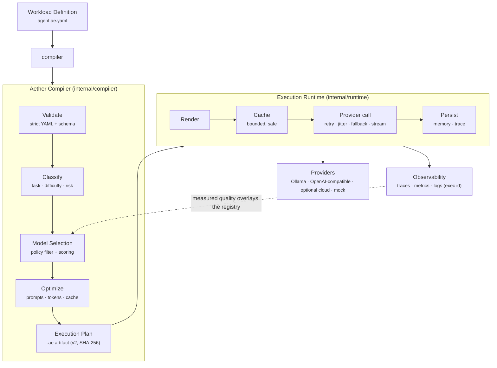

<p align="center">
  
</p>

<h1 align="center">Aether — AI Workload Compiler and Execution Runtime (Go Edition)</h1>

> Aether compiles an AI **workload definition** into a validated, deterministic
> **execution plan**, then runs that plan with retries, fallback, caching, and
> full observability. It picks the right model for the work as part of
> compilation — but model routing is a *supporting capability*, not the product.

**Single static binary · zero third-party Go dependencies · local-first · runs offline after a model is pulled.**

> **Scope note (read this first).** Today a *workload* is a single model
> operation together with its policy, memory, and tools; Aether compiles it to a
> linear execution plan and runs it reliably. The multi-operation compiler and
> runtime — execution graphs (DAGs), cross-operation scheduling, and recovery —
> are the **roadmap**, clearly marked throughout and in
> [`docs/roadmap.md`](docs/roadmap.md). This README never claims a feature the
> code doesn't have; see [`docs/FEATURE_INVENTORY.md`](docs/FEATURE_INVENTORY.md).

---

## 1. Problem statement

AI workloads are usually wired together imperatively: pick a model, call an API,
bolt on retries, hope for the best. That couples the *definition* of the work to
the *mechanics* of running it — so changing a model, a budget, or a reliability
policy means rewriting code, and there is no plan to validate, no artifact to
ship, and no consistent place to observe what happened.

Aether separates the two:

> **How can an AI workload be compiled into an executable plan and executed
> reliably and efficiently under changing runtime conditions?**

You declare *what* to run and *under what constraints*; Aether compiles that into
a validated plan and manages its execution.

## 2. What Aether is

- An **AI Workload Compiler**: it validates a workload definition, selects a
  model under your constraints, optimizes prompts, estimates cost, and emits a
  deterministic, integrity-verified `.ae` artifact.
- An **Execution Runtime**: it runs the compiled plan with context-aware
  execution, retries + fallback, bounded concurrency, caching, memory, and
  structured observability.
- **Local-first**: the default path uses local models (via Ollama) at **$0** and
  stays on your machine. Cloud providers are optional, behind the same interface.

## 3. What Aether is NOT

- Not primarily an **LLM model router** (routing is a supporting capability).
- Not an **API gateway**.
- Not an **offline inference engine** (it does not run model weights itself; it
  delegates to providers like Ollama or any OpenAI-compatible server).
- Not a **prompt-engineering framework**.
- Not a **LangChain-style agent framework**.
- Not a **model-selection utility**.

## 4. Core architecture

Five pillars define the product direction. The table states, honestly, what is
**implemented today** versus **planned** (full detail in
[`docs/FEATURE_INVENTORY.md`](docs/FEATURE_INVENTORY.md)).

| Pillar | Today | Planned |
|---|---|---|
| **A. Workload Compiler** ([docs](docs/compiler.md)) | ✅ validate → select model → optimize → emit deterministic artifact; linear execution steps | ⬜ dependency analysis, execution graphs (DAGs), parallelism detection, multi-operation workloads |
| **B. Execution Runtime** ([docs](docs/runtime.md)) | ✅ single-operation execution, state, cancellation, bounded concurrency | ⬜ scheduling independent operations, DAG execution, intermediate-result passing |
| **C. Reliability & Recovery** ([docs](docs/reliability.md)) | ✅ typed errors, bounded retries + jittered backoff, timeouts/cancellation, fallback | ⬜ checkpointing / recovery across operations |
| **D. Adaptive Optimization** ([docs](docs/optimization.md)) | 🟡 metrics + measured-quality routing feedback; static prompt/cache optimization | ⬜ comparing alternative plans, schedule/resource optimization |
| **E. Observability** ([docs](docs/observability.md)) | ✅ traces, latency (P95), retries/failures, stats, structured logs + execution IDs, reproducible benchmarks | 🟡 in-process CPU/RAM sampling |

See [`docs/architecture.md`](docs/architecture.md) for the full component map and
execution lifecycle.

## 5. How the compiler works

`aether build` turns `agent.ae.yaml` into a `.ae` artifact:

1. **Parse + validate** — strict YAML (tabs, duplicate keys, unknown fields
   rejected with line numbers) and schema validation; input size limits.
2. **Classify** — offline heuristic task analysis (type, difficulty, risk, tools).
3. **Select a model** — the routing pipeline filters by policy
   (cost/quality/latency/privacy) and scores candidates.
4. **Optimize** — compress prompts, estimate tokens, choose a cache strategy.
5. **Emit a plan** — a deterministic `core.ExecutionPlan` with a linear step list,
   written into a versioned, SHA-256-verified `.ae` artifact (reads legacy v1).

Compilation is **deterministic**: the same spec produces a byte-identical
artifact (content-addressed plan ID + `SOURCE_DATE_EPOCH` build time).

## 6. How the execution runtime works

`aether run` executes a compiled plan for one request:

1. Render the system/user prompt (injecting retrieved memory when configured).
2. Consult the bounded cache (safe-to-reuse prompts only).
3. Call the selected model through the provider abstraction, with retries +
   fallback (see §7); stream deltas when `--stream`.
4. Persist memory and cache; record an execution trace.

Execution is **context-aware**: Ctrl-C / SIGTERM cancels in-flight work.

## 7. Reliability and fault recovery

- **Typed errors** — permanent (missing key, model not pulled) vs. transient
  (timeout, temporary network); permanent errors fail fast to the next fallback.
- **Bounded retries** — exponential backoff with jitter; never a retry storm.
- **Timeouts & cancellation** — per-attempt deadlines, caller cancellation
  propagated into provider calls and backoff.
- **Fallback chain** — ordered fallback models, bounded by policy.
- **Structured failure info** on every result.

Planned: checkpoint/recovery across operations (see [`docs/reliability.md`](docs/reliability.md)).

## 8. Adaptive optimization

- **Metrics-driven routing feedback (real):** `aether evaluate` measures models
  on a dataset and writes measured quality that overlays the registry, so future
  compilation routes on *your* data, not vendor priors.
- **Static optimization (real):** prompt compression and cache-strategy selection
  at compile time.
- **Planned:** comparing alternative execution plans and optimizing scheduling —
  adopted only after passing validation. See [`docs/optimization.md`](docs/optimization.md).

## 9. Observability

Execution traces, operation latency (incl. P95), retries and failures, a routing
dataset (JSONL), and `aether stats`. Structured JSON logs (stderr,
`AETHER_LOG_LEVEL`, quiet by default) carry a per-request **execution ID**. See
[`docs/observability.md`](docs/observability.md).

## 10. Architecture diagram



> Planned components (DAG compiler, operation scheduler, recovery engine,
> adaptive optimizer) are intentionally **not** shown as current architecture.

## 11. Installation

Requires **Go 1.26+**. Zero third-party dependencies.

```bash
git clone https://github.com/Orbis-Mind/aether-go
cd aether-go
go build -o aether ./cmd/aether
```

Optional local inference (recommended, $0): install [Ollama](https://ollama.com),
then `ollama serve && ollama pull llama3.2`.

## 12. Quick start

```bash
# Scaffold, check environment, compile, run — fully local
./aether init my-agent && cd my-agent
../aether doctor                 # checks Go, Ollama, models, permissions
../aether build                  # compile agent.ae.yaml -> .ae artifact
../aether run --local --message "Explain caching in one paragraph"
```

No model installed? Everything still works against the mock provider:

```bash
aether run --mock --message "Hello"
```

Inspect the compiled plan:

```bash
aether inspect my-agent-1.0.0.ae
```

## 13. CLI reference

| Command | Description |
|---|---|
| `aether init [name]` | Scaffold a new workload definition |
| `aether build [spec] [-output dir]` | Compile `.ae.yaml` → `.ae` artifact |
| `aether run [artifact] --message M [--local\|--mock\|--strategy S\|--stream\|--json]` | Execute a compiled plan |
| `aether test [spec]` | Validate a spec and show the model-selection decision |
| `aether inspect [artifact]` | Show a compiled plan and its routing |
| `aether models` | Local + catalogue models with quality provenance |
| `aether doctor` | Environment checks (Go, Ollama, models, permissions) |
| `aether evaluate [dataset] [--models k1,k2] [--save]` | Offline, deterministic model benchmark |
| `aether benchmark --runs N` | Runtime cost/latency/quality benchmark |
| `aether stats` | Observability report |
| `aether publish \| pull \| search` | Local artifact registry |
| `aether --version` | Version |

## 14. Configuration reference

A workload is defined in `agent.ae.yaml`:

```yaml
name: my-agent
version: "1.0.0"
description: "What this workload does"

policy:
  quality:   { minimum: 0.80 }     # absolute quality floor (0..1)
  cost:      { max_per_run: 0.01 } # USD budget per run
  latency:   { max_p95: 2000 }     # ms
  privacy:   { level: local }      # hard constraint: never calls cloud
  execution: { local_first: true } # prefer an installed local model
  fallback:  { enabled: true, max_attempts: 2 }

memory:
  semantic: true
  long_term: false
  ttl_seconds: 86400

tools:
  - name: search
    description: Search a knowledge base

prompts:
  system: You are a helpful assistant.
  user_template: "{user_message}"
```

The original flat form (`quality: balanced`, `max_cost_per_run: 0.05`,
`latency: fast`, `prefer_local: true`) is also accepted. Unknown keys are
rejected at compile time.

Environment: `AETHER_LOG_LEVEL` (debug|info|warn|error), `AETHER_LOG_FORMAT`
(json|text), `OLLAMA_HOST`, `OPENAI_API_KEY` / `OPENAI_BASE_URL`,
`ANTHROPIC_API_KEY` — all optional.

## 15. Performance benchmarks (verified, reproducible)

These are **measured** on local models via Ollama on an Apple-Silicon machine.
They describe *these models on these datasets on this hardware* — your numbers
will vary. Nothing here is hand-written; reproduce with `aether evaluate`.

**Aether built-in dataset** (`aether-basic-v1`, 44 tasks, keyword/regex grading):

| Model | Measured quality | Success |
|---|---|---|
| phi3 | 91.7% | 100% |
| gemma2:2b | 83.0% | 100% |

**GSM8K** (external math benchmark, 200 questions, exact-match grading):

| Model | Accuracy | 95% CI | RAM |
|---|---|---|---|
| phi3 (3.8B) | 83.0% | ±5.2% | 3.85 GB |
| qwen2.5:3b | 82.0% | ±5.3% | 2.16 GB |
| llama3:8b | 79.0% | ±5.6% | 5.02 GB |
| gemma2:2b | 59.0% | ±6.8% | 1.93 GB |

Note the larger 8B model is *not* the most accurate here — the point of measured
routing is to pick the smallest model that is actually good enough.

## 16. Roadmap

See [`docs/roadmap.md`](docs/roadmap.md). Near-term direction: an intermediate
representation and **execution graph (DAG)** compiler, an **operation scheduler**
for independent operations, a **recovery engine** (checkpoint/resume), and an
**adaptive optimizer** that compares validated plans. These are goals, not
current features.

## 17. Development and testing

```bash
go build ./...
go test -race ./...        # offline, deterministic
gofmt -l internal cmd tests
go vet ./...
```

CI additionally runs coverage, `govulncheck`, secret scanning, and cross-platform
builds; releases are reproducible (`-trimpath`) and ship an SBOM + `SHA256SUMS`.

## 18. Contributing

Issues and PRs welcome. Please keep the honesty bar: no fabricated capabilities,
distinguish implemented from planned, and add tests for new behavior. Match the
existing zero-dependency, local-first constraints.

## 19. Positioning vs. related projects

Architectural references (categories, not products to copy):

| Project | Category | Aether's difference |
|---|---|---|
| Temporal | Durable workflow engine | Aether is AI-workload-specific: compile + model selection + eval feedback |
| LangGraph | Agent/graph orchestration | Aether compiles a validated plan + artifact; not an agent framework |
| DSPy | Prompt program compiler/optimizer | Aether compiles execution + reliability, not prompt programs |
| Together Compiler | Hosted inference/compilation | Aether is local-first and self-hosted |
| vLLM / SGLang | Inference engines | Aether delegates inference to engines; it does not run weights |
| Arize Phoenix | LLM observability | Aether includes execution observability as one pillar |

Aether does not claim to be first or best in this category, and makes no
superiority claims without reproducible benchmarks.

## 20. License

MIT © Orbis-Mind. Benchmark dataset `aether-basic-v1`: CC0 (original content).
GSM8K: MIT (OpenAI grade-school-math).
