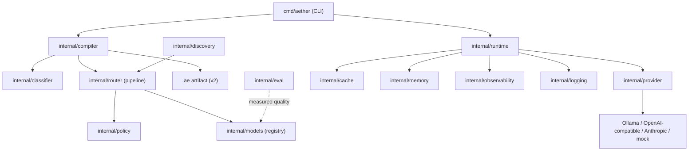

# Aether Architecture

Aether is an **AI workload compiler and execution runtime**. This document maps
the real components and the execution lifecycle, and marks the boundary between
**existing** and **proposed** functionality. Ground truth:
[`FEATURE_INVENTORY.md`](FEATURE_INVENTORY.md).

## Component map (existing)

Supporting packages: `internal/core` (shared types: `AetherSpec`,
`ExecutionPlan`, `ExecutionResult`), `internal/yamlx` (strict YAML),
`internal/registry` (local artifact store).

## Execution lifecycle (existing)

1. **Define** — author `agent.ae.yaml` (a *Workload Definition*).
2. **Compile** (`aether build`) — validate → classify → select model → optimize
   → emit an *Execution Plan* in a `.ae` artifact. Deterministic.
3. **Run** (`aether run`) — render → cache → provider call (retry/fallback/stream)
   → persist memory + *Execution Trace*.
4. **Observe** (`aether stats`, logs) — metrics, traces, routing dataset.
5. **Improve** (`aether evaluate`) — measured quality overlays the registry and
   changes future model selection.

A compiled plan currently describes **one operation** with a fixed linear step
list (`retrieve → inject → render → execute → store → cache`).

## Existing vs. proposed architecture

| Concern | Existing | Proposed |
|---|---|---|
| Plan shape | Linear step list for one operation | Intermediate Representation + Execution Graph (DAG) |
| Scheduling | One operation per run | Operation Scheduler for independent operations |
| Dependencies | None (single operation) | Cross-operation dependency resolution |
| Recovery | Retry + fallback within an operation | Recovery Engine (checkpoint / resume) |
| Optimization | Static (prompts, cache) + routing feedback | Adaptive Optimizer comparing validated plans |

The proposed layer is additive: the existing compiler and runtime become the
single-node case of a graph. No current component is slated for removal.

## Design constraints

- Zero third-party Go dependencies (standard library only).
- Local-first: default execution path is offline and $0.
- Provider-agnostic runtime: all model I/O goes through `ModelProvider`.
- Deterministic compilation and integrity-verified artifacts.

See the per-pillar documents: [compiler](compiler.md), [runtime](runtime.md),
[reliability](reliability.md), [optimization](optimization.md),
[observability](observability.md), [roadmap](roadmap.md).
