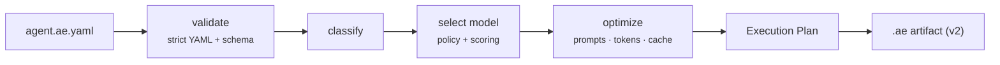

# The Aether Compiler

Pillar A. The compiler (`internal/compiler`) turns a **Workload Definition**
(`agent.ae.yaml`) into a validated, deterministic **Execution Plan**, written as
a `.ae` artifact.

## Existing functionality

### Pipeline (`aether build`)
1. **Parse + validate** (`ValidateYAML`)
   - Strict YAML (`internal/yamlx`): rejects tab indentation, duplicate keys, and
     malformed lines with line numbers.
   - Schema validation: unknown top-level / `policy` / `memory` keys are rejected.
   - Input size limit on the spec file.
2. **Classify** (`internal/classifier`) — offline heuristic analysis: task type,
   difficulty, risk, reasoning/tool needs.
3. **Select a model** (`internal/router` pipeline) — filter candidates by policy
   (cost, quality, latency, privacy), score the survivors, choose one.
4. **Optimize** — prompt compression, token estimation, cache-strategy selection.
5. **Emit** — a `core.ExecutionPlan` embedded in a versioned `.ae` artifact.

### Execution Plan (`core.ExecutionPlan`)
Fields include the selected model, estimated input/output tokens and cost,
optimized prompts, retrieval/cache strategy, task analysis, and a **linear**
`ExecutionSteps` list: `retrieve_context → inject_memory → render_prompt →
execute_model → store_memory → cache_response`.

### Artifact format (`.ae`)
- Versioned container: `magic ‖ size ‖ checksum ‖ zip(payload)`.
- **v2** stores a full SHA-256 and **verifies it on read**; **v1** (legacy
  truncated checksum) is still readable. Bounds-checked and size-limited: a
  corrupt artifact returns an error, never a panic (fuzz-tested).
- **Deterministic**: the same spec compiles to a byte-identical artifact
  (content-addressed plan ID + `SOURCE_DATE_EPOCH` build time).

### Inspect
`aether inspect <artifact>` prints the manifest, plan, and routing decision.

## Not yet implemented (proposed)

- **Intermediate Representation (IR)** distinct from the final plan.
- **Dependency analysis** across multiple operations.
- **Execution Graphs (DAGs)** — the step list is linear and fixed, not derived
  from a dependency graph.
- **Parallel-execution detection**.
- **Multi-operation Workload Definitions** — a workload is a single operation
  today.

## Lifecycle diagram (existing)

Proposed additions (IR, dependency analysis, DAG construction) would sit between
`classify` and `select model`, producing a graph instead of a linear step list.
