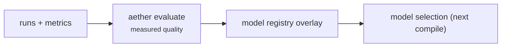

# Adaptive Runtime Optimization

Pillar D. How Aether improves execution over time. This is the **least complete**
pillar; most of it is proposed, and this document says so plainly.

## Existing functionality

### Metrics collection (`internal/observability`)
Every run records latency, tokens, cost, success, retries, and cache status; a
routing dataset (JSONL) captures task features and outcomes.

### Measured-quality routing feedback (real)
`aether evaluate` scores models on a dataset with deterministic grading and
writes **measured** per-task quality, which overlays the model registry. Future
compilation then selects models using measured quality (provenance `meas`) rather
than estimated priors (`est`). This is a genuine feedback loop from observed
results back into model selection.

### Static compile-time optimization (real)
- Prompt compression (whitespace/filler reduction) with token accounting.
- Cache-strategy selection based on task complexity.

## Not yet implemented (proposed)

- **Adaptive Optimizer** that **compares alternative execution plans**.
- **Scheduling / resource-allocation optimization** (needs the DAG runtime).
- **Bottleneck identification** driving automatic plan changes.
- A **validation gate**: an optimization candidate must pass correctness and
  performance checks before adoption — **no optimization is auto-adopted without
  validation**. This policy is defined now; the machinery is future work.

## Correctness principle (design commitment)

When the optimizer is built, it must never adopt a candidate plan that has not
passed validation against the baseline on both correctness and performance. Today
there is no automatic plan rewriting, so there is nothing that could bypass this
rule — but the rule is stated here so the implementation inherits it.

## Feedback loop (existing portion)

