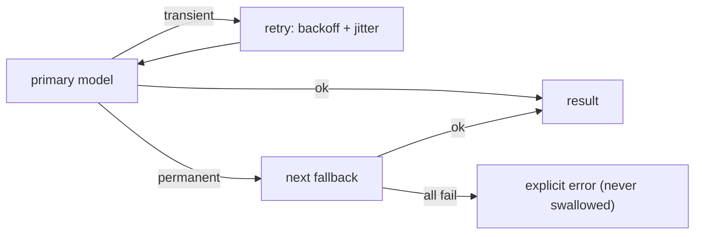

# Reliability and Fault Recovery

Pillar C. How Aether handles failure during execution.

## Existing functionality

### Typed errors (`internal/provider`)
- `PermanentError` — retrying cannot help (missing API key, model not pulled,
  auth failure). The runtime fails fast and moves to the next fallback.
- `TransientError` — retryable (timeout, temporary network, provider 5xx).
- Context cancellation (`context.Canceled`) is propagated, not misreported;
  timeouts are surfaced as transient, not as "unreachable".

### Retries and backoff (`internal/runtime`)
- Configurable `MaxRetries`; exponential backoff with ±25% jitter — bounded, no
  retry storms.
- Backoff is interruptible: caller cancellation wakes it immediately.

### Timeouts and cancellation
- Per-attempt deadlines derived from the caller's context.
- `ctx.Err()` is checked before each attempt; cancellation aborts the whole run.

### Fallback
- An ordered fallback-model chain, bounded by `FallbackMaxAttempts`.
- A permanent failure on one model skips straight to the next.

### Structured failure information
- Every `ExecutionResult` carries success/failure, the error string, retry count,
  and the model actually used.

## Not yet implemented (proposed)

- **Recovery Engine**: checkpointing and resume **across operations**. Today a
  plan is a single operation, so there is no partial multi-step progress to
  checkpoint. This becomes meaningful once the DAG runtime exists.
- **Idempotency / exactly-once** guarantees across a multi-operation graph.

## Failure flow (existing)

