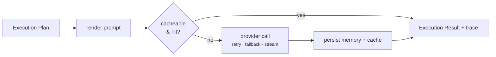

# The Execution Runtime

Pillar B. The runtime (`internal/runtime`) executes a compiled Execution Plan.

## Existing functionality

### Execution (`Run` / `RunContext` / `RunStream` / `RunStreamContext`)
For one request against a compiled plan:
1. **Render** the system/user prompt, injecting retrieved memory when the plan's
   retrieval strategy requires it.
2. **Cache lookup** — only for prompts marked safe to reuse (`cache.Cacheable`).
3. **Provider call** through `internal/provider`, with retries + fallback (see
   [reliability](reliability.md)); streams deltas when requested.
4. **Persist** — memory (semantic/long-term) and cache; record an execution trace.

### Execution state and semantics
- **Context-aware**: `RunContext`/`RunStreamContext` thread a `context.Context`;
  the CLI wires `signal.NotifyContext`, so Ctrl-C / SIGTERM cancels in-flight work.
- **Per-run state** (`ExecutionResult`): model used, tokens, cost, latency,
  retries, cache hit, execution ID, error.
- **Bounded concurrency**: per-attempt timeouts; deterministic single-operation
  ordering (render → cache → model → persist).
- **Provider-agnostic**: all model I/O goes through the `ModelProvider` interface;
  the runtime contains no provider-specific code.

## Not yet implemented (proposed)

- **Operation Scheduler** for independent operations.
- **Cross-operation dependency handling** and **intermediate-result passing**.
- **DAG execution** — the runtime executes one operation per run today.

## Execution diagram (existing)

Proposed: a scheduler would drive many such operations according to an execution
graph, passing results along edges.
